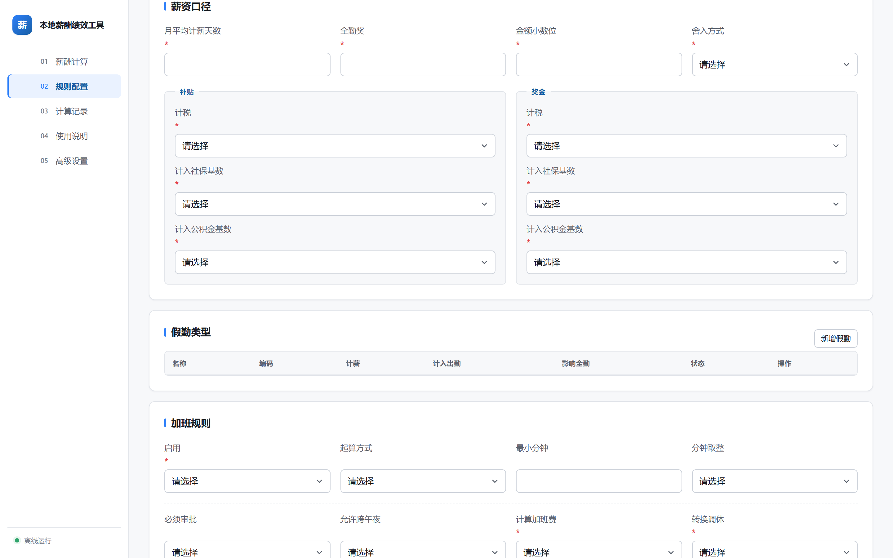

# 通用薪酬绩效工具

一个由 HR 在 App 内配置规则的本地离线薪酬与考勤计算工具，支持固定工时、弹性工时、法定缴纳、商业保险、累计个税和员工例外。本项目不包含任何真实员工、考勤、薪酬或公司专属制度数据。

## 界面预览

### 规则配置总览


### 公司制度配置



详见 [产品设计](docs/specs/2026-08-13-general-payroll-tool-design.md)。

完整操作见 [使用指南](docs/USER_GUIDE.md)，员工文件字段见 [薪酬文件说明](docs/hr-workbook.md)。

安装包用户请先阅读 [安装说明](docs/INSTALL.md) 和 [升级说明](docs/UPGRADING.md)。当前 `0.2.0-beta.3` 为免费、开源、未签名的桌面测试版。

## 实现要点

### 界面

- `static/workspace.css`（约 1300 行）建立统一的设计令牌体系（颜色、间距、圆角、字号、阴影）
- 侧边栏为带序号的分组导航；规则页签为分段控件；含规则完成度进度条
- 表格、弹窗、按钮、表单控件、空状态、加载态使用统一组件样式
- `static/workspace-responsive.css` 负责窄屏布局
- 提供暗色模式变量（`prefers-color-scheme`）

### 日期控件（flatpickr）

原生 `input[type=date]` / `input[type=month]` 的弹出面板由浏览器 UA shadow DOM 渲染，CSS 无法定制；且 Chromium 在聚焦时会自动全选内部子段并绘制蓝色高亮，同样无法用作者样式覆盖。

因此使用 [flatpickr](https://flatpickr.js.org/) 4.6.13 接管（`static/date-picker.js`）：

- 采用 `altInput` 模式，原生 input 降级为 `type="hidden"` 的值载体，页面上呈现普通文本输入框
- 月份字段使用 `monthSelectPlugin`，日期字段使用默认日历，均配中文 locale
- 表单值格式为 `YYYY-MM` / `YYYY-MM-DD`
- 资源已本地化到 `static/vendor/flatpickr/`，**不依赖 CDN**，保持离线可用

### 使用说明

按 `docs/USER_GUIDE.md` 与 `docs/hr-workbook.md` 的业务约束组织为：四步流程卡片、计算状态对照表、三条关键规则提醒，以及「输入文件字段速查」「常见问题」两个折叠区。

### 布局修复

- 三个页面的标题因 `flex` 布局被推到右端（`<header>` 内 `<p>` 与 `<h1>` 未包裹在同一容器）
- 窄屏下 grid 子项默认 `min-width:auto` 导致的横向溢出

### 验证状态

- 全量测试：366 passed / 1 skipped
- Windows 打包已验证：`python scripts/build_desktop.py` 产出可运行 exe，WebView2 正常加载，静态资源全部可达
- **已知未验证项**：暗色模式未经视觉验证；界面在真实 WebView2 下的渲染效果未逐屏截图确认

## 本地运行

需要 Python 3.11 或更高版本。macOS 与 Windows 使用同一套源码，安装包需分别在对应系统构建。

```bash
python -m venv .venv
python -m pip install -e .
python app.py
```

工具只监听 `127.0.0.1`。每位使用者在自己的电脑上独立运行，上传文件不会发送到项目维护者或其他用户的电脑。

规则配置只有公司制度、法定政策、商业保险和员工例外四个页签；每日标准工时与月平均计薪天数均由 HR 输入。计算时选择已发布规则版本，只上传当前周期考勤 XLSX 和员工薪酬 XLSX，不上传规则包。结果文件及计算记录保存在当前电脑，发布规则快照不可变，历史计算不会被后续制度修改覆盖。

当前开发状态见 [CHANGELOG](CHANGELOG.md)。macOS 与 Windows 安装包由 GitHub Actions 在对应系统原生构建；由于项目不购买商业签名证书，首次打开会显示系统安全提示。
